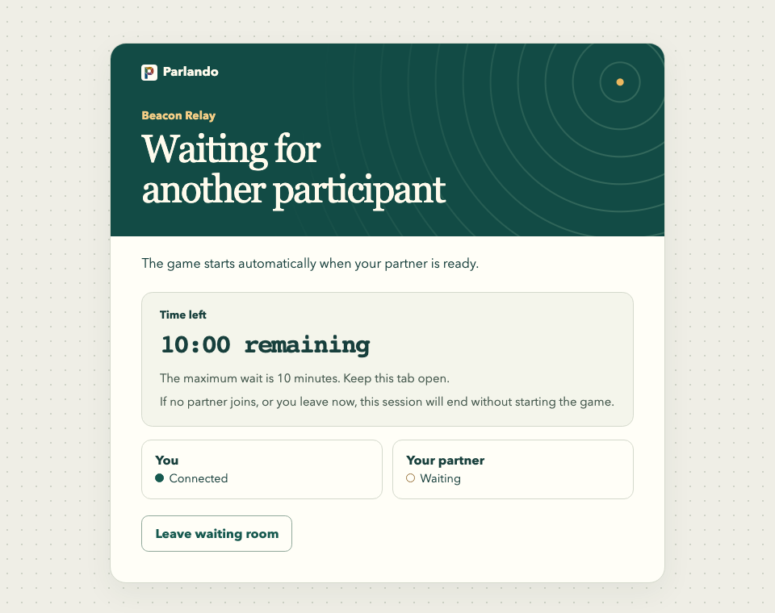
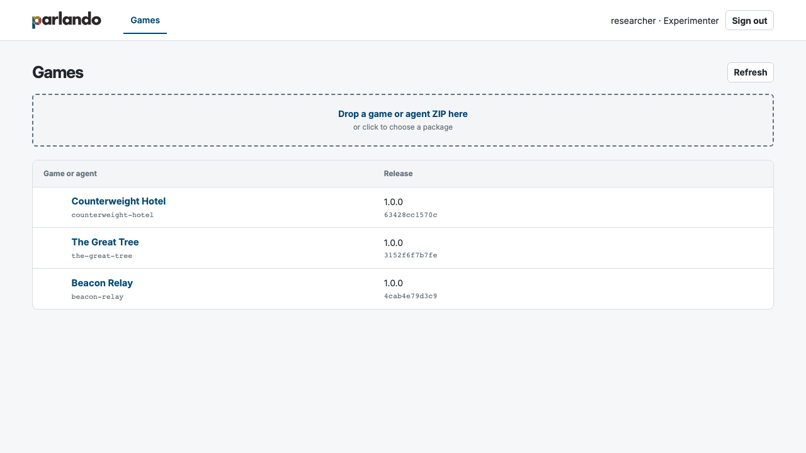

# 

<table>
  <tr>
    <th scope="row" align="left" valign="middle">Core</th>
    <td align="left" valign="middle">
      
      
    </td>
  </tr>
  <tr>
    <th scope="row" align="left" valign="middle">Rust game/agent SDK</th>
    <td align="left" valign="middle">
      
    </td>
  </tr>
  <tr>
    <th scope="row" align="left" valign="middle">Python SDKs</th>
    <td align="left" valign="middle">
      
      
    </td>
  </tr>
</table>

Parlando is a platform for crowdsourcing dialogue games. In a dialogue game, two players share a task in a web browser. They each see only part of the situation, and they talk or type to each other to complete the task. Parlando records what the players said next to what they did. This lets a researcher ask how communication and action relate: for example, when a listener asks for clarification, and whether the answer changed their next move.

Parlando goes beyond earlier platforms for dialogue games by permitting speech-based dialogue between the players' web browsers; rendering of arbitrary Javascript dialogue games; and seamless transitions between training a player agent against another agent and evaluating it with human players. It has a strong focus on experiment privacy and comes with an LLM skill for developing new games. You can have your first Parlando game up and running within five minutes of installation.

## How Parlando is organized

A Parlando **game** consists of a Javascript frontend that is shown in the player's browser, together with a small backend that defines what actions are legal and what each player can observe. Parlando supplies everything else that a study needs: participant entry and consent, pairing, the speech or chat channel, monitoring, and data export. A game is written once and deployed to a long-running **host**. On the host, an **experiment** is one study condition for one game, and a **session** is one play-through of that game by two players.

## Speech or typed chat

Each experiment uses either typed chat or live speech, and the same game build supports both. In a typed condition, players see a message history and a text field below or beside the game. In a speech condition, they see their microphone status and a mute control, and Parlando streams audio between the two browsers. With transcription enabled, Parlando sends the speech to a transcription service and stores the final text, with word timings where the service provides them. This minimizes the personally identifiable information that we store, while still permitting fine-grained analysis of spoken conversations.

<!-- SCREENSHOT PLACEHOLDER (docs/images/speech-widget.png):
     A game in a speech condition, with the microphone level meter, connection
     status, and mute control visible next to the board. -->

## Human and agent players

Each role in a game can be played by a person or by an agent. This gives three kinds of sessions. Human–human sessions produce a dialogue corpus. Human–agent sessions test how an agent performs with people. Agent–agent sessions run in batches without a browser, which makes them suitable for evaluation and for reinforcement learning.

All three kinds of sessions run the same game rules, and an agent receives only the view that its role would show a person. As a result, you can train a policy in agent–agent games, save a checkpoint, and then assign that checkpoint to a role in a live experiment with human partners. A policy that succeeds with another agent can then be tested with people on the same task.

Agents can be packaged with the game or run in a standalone Python process. They receive and send messages as text strings. In a speech condition, Parlando passes transcripts to the agent and synthesizes the agent's replies as audio.

<!-- SCREENSHOT PLACEHOLDER (docs/images/agent-agent-run.png):
     Terminal output of `parlando run` for a batch of agent–agent sessions,
     showing completed sessions, outcomes, and the output directory. -->

## Recruitment through Prolific

Participants join a study through a direct link or through [Prolific](https://www.prolific.com/). Parlando reads the Prolific participant, study, and session identifiers from the link. It then shows the consent page, places participants in a waiting room until a partner is ready, and runs the game. At the end, it sends each participant back to Prolific with the completion code that matches the outcome. You configure separate completion paths for finishing the game, declining consent, and timing out in the waiting room. You can rehearse the whole procedure in a local preview, and preview sessions are kept out of the research data.

## Privacy and consent

Parlando is designed to keep as little personal data as a study requires. Speech is processed live and the audio is discarded; only transcripts are stored. Exports use pseudonymous labels for participants and dialogues. The resulting corpus exports thus do not contain any personally identifiable data, beyond what the participant themselves revealed in their messages.

Parlando allows you to ask for a participant's consent to privacy-related items. Participants have to explicitly check each consent item before playing the game. Participants who do not give their consent do not enter the game and are not stored in the database. You can select pre-written consent items or write your own.

For each experiment, Parlando produces a privacy report that lists the data it stores and the external services it uses, such as a transcription provider. You can use this report to describe the actual procedure to participants and to your ethics board. The [privacy materials](https://coli-saar.github.io/parlando/manual/privacy/) include a participant information template and material for an institutional data-protection review.

<!-- SCREENSHOT PLACEHOLDER (docs/images/consent-page.png):
     The participant consent page with the study information link, the
     consent statement, and the accept and decline controls. -->

<!-- SCREENSHOT PLACEHOLDER (docs/images/privacy-report.png):
     The privacy report of an experiment in the dashboard, listing the stored
     data fields and the external services. -->

## Games and agents as WebAssembly components

Games and agents in Parlando are packaged as [WebAssembly](https://webassembly.org/) (WASM) components. They are deployed to the long-running Parlando host through uploads in the web dashboard or through the `parlando` command-line tool. Because games and agents are distributed as WASM, you can write them in any programming language that compiles to WASM. Parlando comes with SDKs for game and agent development that support Rust and Python. These SDKs hide all details of the WASM interface from the developer; your source code can remain readable and succinct.

Games also need a frontend that will run in the participants' web browser. These games are written in Javascript and can do whatever you want. Parlando comes with a Javascript client library that takes care of consent collection, matchmaking, speech and audio processing, and communication with the Parlando server.

## Building games with an LLM coding assistant

Parlando includes a [game creation skill](skills/generate-parlando-game/SKILL.md) for LLM coding assistants such as Claude Code or Codex. Given a description of the rules, the skill guides the assistant through implementing the game, its browser interface, and optional agents, and through testing and packaging the result with the Parlando command-line tool. The output is an ordinary Parlando game that you can read, change, and test like one written by hand.

<!-- SCREENSHOT PLACEHOLDER (docs/images/game-skill.png):
     A coding-assistant session using the generate-parlando-game skill, ending
     with `parlando test` passing and a built package. -->

## Getting started

The [Beacon Relay walkthrough](https://coli-saar.github.io/parlando/manual/start/getting-started/) installs Parlando and takes you through a complete local pilot. You play both roles in separate browser profiles, exchange a message, and inspect the session in the dashboard. This lets you check both what participants experience and the record you would analyze.

The [experimenter manual](https://coli-saar.github.io/parlando/manual/) covers study design, data collection, and deployment in detail.

| Task | Documentation |
| --- | --- |
| Run a study with people | [Configure an experiment](https://coli-saar.github.io/parlando/manual/run/configuration/) · [Recruit through Prolific](https://coli-saar.github.io/parlando/manual/run/prolific/) |
| Choose speech or typed chat | [Configure communication](https://coli-saar.github.io/parlando/manual/build/voice/) |
| Prepare participant information and consent | [Consent and privacy settings](https://coli-saar.github.io/parlando/manual/run/consent-privacy/) · [Privacy materials](https://coli-saar.github.io/parlando/manual/privacy/) |
| Analyze the dialogue and game records | [Monitor sessions and export results](https://coli-saar.github.io/parlando/manual/run/data-operations/) |
| Train or evaluate an agent | [Agent–agent runs](https://coli-saar.github.io/parlando/manual/build/agent-agent/) · [Use an agent in a live game](https://coli-saar.github.io/parlando/manual/build/agents-and-voice/) |
| Create a new game | [Build a game in Rust or Python](https://coli-saar.github.io/parlando/manual/build/create-game/) · [Package a game](https://coli-saar.github.io/parlando/manual/build/packages/) |
| Deploy to a shared host | [Deploy](https://coli-saar.github.io/parlando/manual/deploy/) · [Operate a host](https://coli-saar.github.io/parlando/manual/deploy/host/) |
