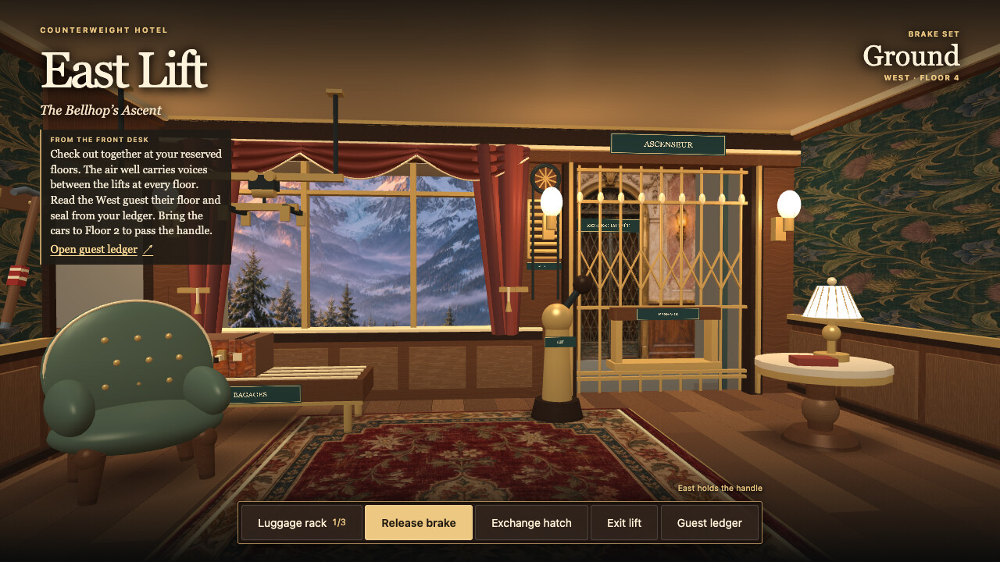
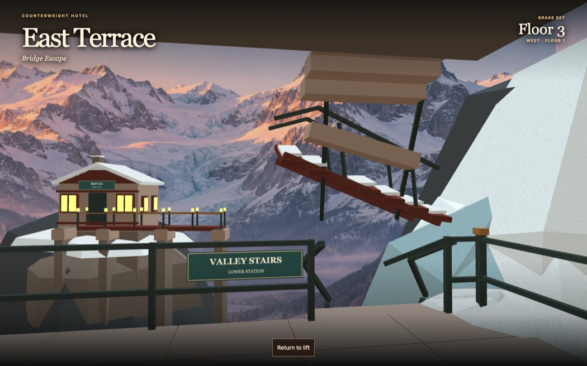
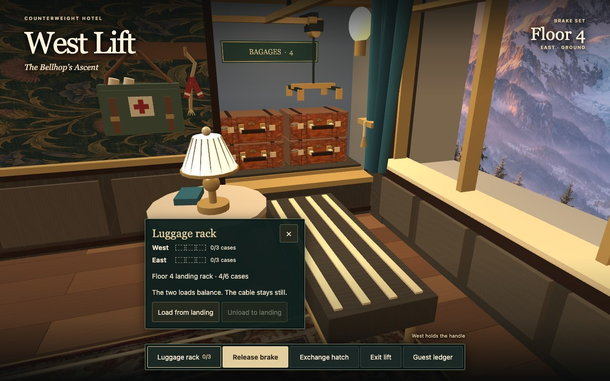

# Counterweight Hotel

An avalanche has buried the valley stairs and severed the hotel’s steam main. The mountain patrol has a fire and beds at the refuge. You and the guest across the shaft occupy the East Room and the West Room, two counterweighted hotel rooms. Each wing has one rescue bridge. Bring both lifts to those bridges, open the gates and reach the refuge together.



## Start a game

From the Parlando repository root, run:

```sh
games/counterweight-hotel/run.sh
```

Open the [hotel dashboard](http://127.0.0.1:8081/admin/experiments). On a fresh installation, create the administrator and an experiment. Use **Human vs human** for a pair or **Human vs agent** with **Hotel porter** for one guest. Enable live voice for a human pair. Each guest selects **Prepare voice** in the lobby and grants microphone access. Either guest can mute at any time. Select typed communication for text chat. The local solo demo uses a text porter. The default game configuration `{}` selects **Bridge Escape**. To play **Rescue Supplies** as a separate game, set the experiment’s game YAML to `route: rescue_supplies`. The porter settings are `{}` for either route. Activate the experiment and open its participant link. On one computer, two humans can use separate browser profiles. The dashboard and its participant URLs share the same host, port, and database. After restarting the server, activate the desired experiment again.

## Explore the hotel

The framed rescue bridge sign names the room across the shaft and records its bridge floor and gate seal. The guest across the shaft has the information for your wing. You can talk through the air well throughout the ride.

While the lift is parked, walk through its terrace doorway to explore the avalanche damage and look across the ravine. Walk back through the doorway to board. **Step outside** and **Return to East Room** or **Return to West Room** also work by keyboard or touch. The lift interlock holds both cars while either guest is outside.



While your lift moves, a climbing cable whine and quick ratchet mark ascent. A lower drum growl and paired knocks mark descent. The sound follows your car even when you face away from the shaft.

Walk with WASD or the arrow keys and drag the view to turn. On a touchscreen, hold a direction on the movement pad and drag the scene with a second finger to look around.

Open **Camera** beneath the room name to adjust the vertical field of view and the two travel animations independently. Lift rides are animated by default. **Walk to refuge** cuts to the porch by default. You can enable its guided camera movement or walk the crossing yourself. Each browser remembers its settings.

Hover over a furnishing to outline it in turquoise and see its action above the controls. Click to use it, or tap it directly on a touchscreen.

Click or tap the route sign to read the same print up close. The room-named route button opens it by keyboard. Click a suitcase on the landing rack to bring it aboard. Click a suitcase in your lift to send it out through the service bay. The numbered landing racks stay with the building. **Suitcase rack** also provides keyboard controls for dispatch. You can inspect the exchange hatch, landing lock, workshop plate, and house bulletin, and the on-screen controls provide keyboard access to the same actions. Your position within the suite stays local as both lifts travel.



<details>
<summary>Puzzle walkthrough (spoilers)</summary>

- **Find the way out.** Tell the other guest their bridge floor and gate seal from your route sign. For example, the solo porter understands `Floor 1, rose`. In Rescue Supplies, include the suitcase count, such as `Floor 1, rose, 2 suitcases`.
- **Move the lifts.** The cars share a cable and carry up to three equal-weight suitcases each. With both cars empty in Bridge Escape, East can load one suitcase and release the brake to descend from Floor 3 to Floor 2. The heavier car moves down one floor per release. The lever springs back and the brake catches automatically at the next landing. Suitcases left on a landing stay there. If the local rack runs out of stock or space, the suitcase hoist serves the nearest available rack.
- **Power the bridges.** At Floor 2, the hatches align. Passing the brass key seats it in the West master switch, energizing the bridge lamps and unlocking West’s brake. The solo porter waits for its own bridge clearance before driving from this stop. It accepts the floor, seal and any supply count across separate messages.
- **Collect the consignment on Rescue Supplies.** The waybill identifies the East dispensary stop. Dock East at Floor 1 with the circuit live and both guests aboard. The green, cross-marked suitcase needs one free slot and counts toward East’s delivery. Click it in the service bay or use **Collect dispensary suitcase** at the suitcase rack. The suitcase stays strapped aboard. Reverse the ballast to carry the shipment up to the bridge. At the bridges, adjust the remaining ordinary suitcases to the two private manifest counts.
- **Cross the bridges.** Park both cars at the rescue landings. The inspector’s seal unlocks each gate. The freight scale on a supply run must clear before the seal release engages. A wrong seal trips only that gate’s spring. It can be rewound at the brake pedestal. Walk through your open gate and follow the gallery and bridge to the refuge, or select **Walk to refuge** for a guided crossing. The celebration begins once both guests arrive. The two lamps on the refuge porch register the guests independently.

</details>

## Author another itinerary

The route definitions in [the Rust game](server/src/lib.rs) specify the East car’s starting and destination floor ranges, both initial suitcase counts, and an optional freight order with an East stores floor and delivery ranges. The session seed selects values inside those inclusive ranges. The West car’s floor is always four minus the East car’s floor.

A route combines a starting position, bridge locations, initial ballast and an optional freight pickup and manifest. The same cable, brake key, gate seals and porter policy serve each route.

## Build and storage

Install Rust's `wasm32-unknown-unknown` target, `wasm-tools`, and Node.js.
The launcher builds the component and its browser application, then starts the
game's custom host with **Hotel porter** available. Add `--build-only` to build
`dist/counterweight-hotel-0.1.0.zip`. The portable package also supports human pairs and remote
agents on a deployment host. Follow the [local pilot walkthrough](../../docs/web/content/manual/start/getting-started.md#start-a-local-server)
with game ID `counterweight-hotel`. To start the deployment host from the
launcher, pass
`--without-bundled-agents`. It stores packages and experiment data under
`.local/host` by default.

The default port is `8081` and the database is `.local/component.sqlite`.
Override them with `PORT` and `PARLANDO_DATABASE_URL`. To exercise the seeded
routes and porter policy from the repository root, run:

```sh
cargo test --manifest-path games/counterweight-hotel/server/Cargo.toml --features bundled-agents
```

## Package the hotel porter policy

Run `./run.sh --build-only` from this game directory. The launcher builds the game, records its ZIP path, version and SHA-256 in `agent.yaml`, and builds the compatible policy ZIP. Upload the game ZIP before its agent ZIP. To produce only the game, pass `--without-bundled-agents --build-only`.

## Landscape credits

The Alpine skyline wraps the original alpenglow mountain artwork around the hotel.

## Deploy to Railway

Build the game ZIP from this directory and upload it to your shared host. See [Deploy Parlando on Railway](../../docs/web/content/manual/deploy/railway.md) for server setup, package uploads, and game activation.
