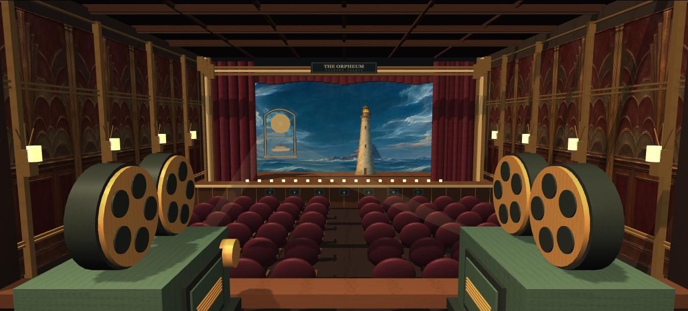

# The Last Screening

Two operators are locked inside the Orpheum. From the booth, the projectionist loads glass slides and aims two lanterns. From the wings, the stagehand positions an aperture and an opaque tower. Each operator has part of the cue sheet. Completing the evening’s two reels lifts the safety curtains over both exits.



## Build and deploy

From this directory, build the packages, then upload them to a running Parlando server. The build requires Rust’s `wasm32-unknown-unknown` target, `wasm-tools`, Python 3, and Node.js. Replace `lab` with your server URL or configured alias.

```sh
./build.sh
parlando login --server lab
./deploy.sh --host lab
parlando activate --host lab --game last-screening
```

Sign in once per server. The deploy script uploads the game first, followed by its agents. Omit `--host` to use your CLI’s default server. Open the game from **Games** in the server dashboard to configure an experiment and start intake.

The game settings are `{}`. Give the participant URL to both players. On one computer, use two separate browser profiles or a regular window and a private window. Text conversation works with the default setup. Configure voice in the dashboard if desired.

## Play solo with the screening partner

Create a separate experiment in the dashboard. Set **Participant pairing** to **Human vs agent**, choose **Screening partner**, save the configuration, and activate the experiment. Open its participant URL in one browser window. The policy needs no model, API key, or separate process.

With the default game settings you operate the projection booth. To play backstage, set the game YAML to `projectionist_seat: b` before activation. At the start of each reel, read the partner’s mark in the intercom and reply with the number on your own cue card. For example, if your card says *Tower at 4*, send `4`. The partner then works its equipment while you operate yours. Exchange marks again when the cue sheet turns.

## Operate the theater

Drag inside the scene to look around. Click a lantern or fly rail to inspect it, or use the labeled equipment buttons. With focus in the game, **1** and **2** select the two stations and **0** returns to the room view. The booth can change slides and aim at one of seven marks. The wings can move the two pieces of scenery along those marks. The cue drawing shows the mark assigned to your room. Tell your partner what it says.

*Moonrise at Bell Rock* calls for the moon framed by the window. *Midnight Crossing* keeps the same window lit while the ship moves behind the tower and emerges on the other side. Both players must pass through their own exit to finish.

## Build locally

The build writes the browser assets to `client/web/dist/`.

For a single-seat visual preview, build once, then run `npm run dev` from `client/web/` and open `/?preview` on the printed Vite URL. The preview offers a choice of room and reel and lets you operate that seat’s equipment. Live two-player sessions run through the participant URL.

## Author another reel

Edit the production score in [server/src/production.rs](server/src/production.rs). Each reel has an ID, a list of conditions that must remain true throughout the reel, and a nonempty sequence of frames. Every frame names a phase and a condition on the current picture. The stage must also match the two cue marks, which the server deals separately for each reel from the session seed.

For example, the crossing holds `InWindow(Light)` throughout. Its three frames compare the ship’s position with the tower using `AtTower(Ship, Less)`, `AtTower(Ship, Equal)`, and `AtTower(Ship, Greater)`. Losing the light or moving a flat off its mark resets the sequence. The score’s unit test gives a second composition using these same pieces: hold the ship in the window and move the moon across the tower in the opposite direction.

Add the reel to `PRODUCTION` in performance order. Give its ID and phases cue copy in [client/web/src/game.ts](client/web/src/game.ts) and an illustrated cue in [client/web/src/GameView.tsx](client/web/src/GameView.tsx). Reels using the existing slides and flats share the same controls and scene geometry. Run `cargo test --manifest-path server/Cargo.toml` from this directory to check the mechanics.
